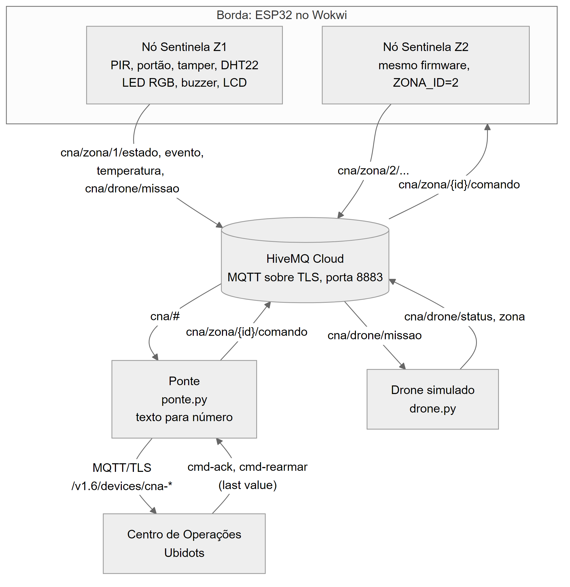
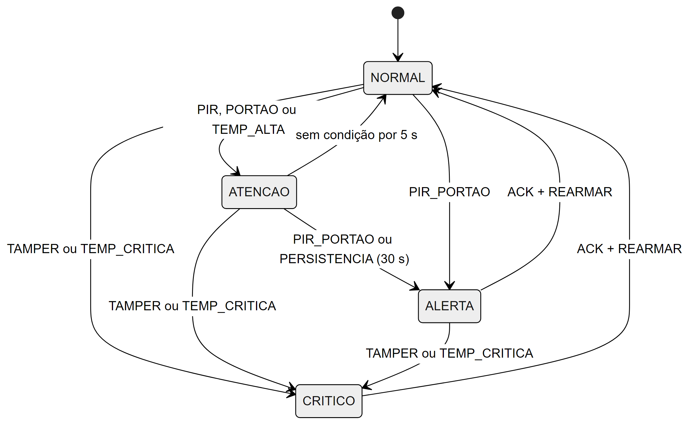

# Nó Sentinela de Borda – Centro Nuclear Atlântico

Sistema de vigilância de borda para duas zonas do Centro Nuclear Atlântico (CNA), uma instalação fictícia. Cada zona tem um ESP32 que detecta intrusão, abertura de portão, violação do equipamento e temperatura alta, reage na hora com LED, buzzer e LCD e avisa o centro de operações por MQTT com TLS. Em ALERTA ou CRÍTICO o nó chama um drone simulado para inspecionar a área.

Projeto da Sprint de Edge Computing (Challenge FIAP com a Marinha do Brasil/Amazul), Ciência da Computação, FIAP, 2026.

## Integrantes

| Nome | RM | Papel |
|---|---|---|
| Maykon Santana Fonseca | RM567041 | Firmware dos nós sentinela (ESP32), máquina de estados e comunicação MQTT/TLS |
| Gustavo Franzoti Gonçalves | RM566983 | Centro de operações (dashboard), drone simulado, integração e relatório |

- Repositório: https://github.com/mykofonseca/cna-sentinela-edge
- Simulação no Wokwi (Z1): https://wokwi.com/projects/LINK_WOKWI_Z1
- Simulação no Wokwi (Z2): https://wokwi.com/projects/LINK_WOKWI_Z2

## Arquitetura



Os nós publicam no HiveMQ Cloud. O Ubidots não assina um broker externo, então a ponte (`ponte/ponte.py`) assina `cna/#`, converte os textos em números e publica no broker MQTT do Ubidots. No caminho inverso, ela assina as variáveis de comando do painel (`cmd-ack`, `cmd-rearmar`, `cmd-armar`, `cmd-desarmar`) e publica em `cna/zona/{id}/comando`. O drone (`drone/drone.py`) conversa direto com o HiveMQ.

Máquina de estados do nó:



## Tecnologias

- ESP32 (Arduino via PlatformIO, `espressif32@6.9.0`), simulado no Wokwi
- PubSubClient, WiFiClientSecure com o certificado ISRG Root X1, DHT sensor library, LiquidCrystal_I2C
- FreeRTOS: rede em uma tarefa no núcleo 0, lógica local no núcleo 1
- HiveMQ Cloud (MQTT 3.1.1, TLS na porta 8883)
- Python 3.10+ com paho-mqtt 2.x, python-dotenv e certifi
- Ubidots STEM como centro de operações

## Estrutura

```
firmware/sentinela   projeto PlatformIO (env:z1 e env:z2), diagram.json e wokwi.toml
drone/drone.py       drone simulado
ponte/ponte.py       ponte HiveMQ <-> Ubidots
docs/                relatório (DOCX e PDF), diagramas, prints e roteiro do vídeo
```

## Como rodar

### 1. Clonar e configurar credenciais

```bash
git clone https://github.com/mykofonseca/cna-sentinela-edge.git
cd cna-sentinela-edge
cp firmware/sentinela/include/secrets.example.h firmware/sentinela/include/secrets.h
cp .env.example .env
```

Em `secrets.h`, preencha `MQTT_HOST` (endereço do cluster no HiveMQ Cloud), `MQTT_USUARIO` e `MQTT_SENHA` com uma credencial criada em *Access Management* do cluster. O Wi-Fi já vem como `Wokwi-GUEST`, sem senha. No `.env`, preencha os mesmos dados do HiveMQ e o `UBIDOTS_TOKEN` (Ubidots, menu do usuário, *API Credentials*). Os dois arquivos estão no `.gitignore`.

### 2. Firmware e simulação

Com o PlatformIO instalado (`pip install platformio` ou extensão do VS Code):

```bash
cd firmware/sentinela
pio run -e z1        # gera .pio/build/z1/firmware.bin
pio run -e z2
```

No VS Code com a extensão Wokwi, abra `diagram.json` e rode *Wokwi: Start Simulator*. O `wokwi.toml` aponta para o build da Z1; para a Z2, troque `z1` por `z2` nos dois caminhos. Para rodar as duas zonas ao mesmo tempo, use os dois projetos online do Wokwi (links acima), cada um com o valor padrão de `ZONA_ID` ajustado em `config.h` (1 ou 2).

Horário permitido: das 7h às 19h (`HORA_INICIO` e `HORA_FIM` no `platformio.ini`). Para demonstrar a regra de "fora do horário" a qualquer hora, publique no tópico `cna/zona/{id}/teste`:

| Payload | Efeito |
|---|---|
| `FORA_HORARIO` | força fora do horário |
| `DENTRO_HORARIO` | força dentro do horário |
| `HORARIO_REAL` | volta a usar o relógio do NTP |

### 3. Ponte e drone

```bash
python -m venv .venv
.venv\Scripts\activate          # Linux/macOS: source .venv/bin/activate
pip install -r ponte/requirements.txt
python ponte/ponte.py           # terminal 1
python drone/drone.py           # terminal 2
```

Sem `UBIDOTS_TOKEN` a ponte só mostra no terminal o que mandaria ao painel, o que ajuda a testar o fluxo do HiveMQ.

### 4. Painel no Ubidots

Os dispositivos `cna-z1`, `cna-z2` e `cna-drone` são criados sozinhos na primeira publicação da ponte. Em cada zona: indicador de cor na variável `estado` (0 verde, 1 amarelo, 2 laranja, 3 vermelho), gráfico de linha em `temperatura`, tabela de valores em `evento` (com o texto no context) e dois widgets de botão ligados a `cmd-ack` e `cmd-rearmar` que gravam 1. No drone: `etapa`, `zona` e `resultado`.

## Mapa de tópicos

| Tópico | Direção | Exemplo | Observação |
|---|---|---|---|
| `cna/zona/{id}/temperatura` | Nó -> Broker | `31.5` | a cada 10 s |
| `cna/zona/{id}/estado` | Nó -> Broker | `ALERTA` | na mudança e a cada 30 s, retido |
| `cna/zona/{id}/evento` | Nó -> Broker | `PIR_PORTAO` | a cada transição ou comando |
| `cna/zona/{id}/comando` | Broker -> Nó | `ACK` | `ACK`, `REARMAR`, `ARMAR`, `DESARMAR` |
| `cna/drone/missao` | Nó -> Drone | `Z1` | uma vez por ciclo de alarme |
| `cna/drone/status` | Drone -> Broker | `EM_ROTA` | retido |
| `cna/zona/{id}/conexao` | Nó -> Broker | `OFFLINE` | LWT, retido |
| `cna/zona/{id}/modo` | Nó -> Broker | `DESARMADO` | retido (extra) |
| `cna/zona/{id}/pir` | Nó -> Broker | `1` | na mudança (extra, usado pelo drone) |
| `cna/zona/{id}/horario` | Nó -> Broker | `FORA` | retido (extra) |
| `cna/zona/{id}/teste` | Broker -> Nó | `FORA_HORARIO` | só para demonstração (extra) |
| `cna/drone/zona` | Drone -> Broker | `Z2` | zona do voo atual (extra) |
| `cna/drone/conexao` | Drone -> Broker | `ONLINE` | LWT, retido (extra) |

Códigos numéricos no Ubidots: estado `NORMAL=0, ATENCAO=1, ALERTA=2, CRITICO=3`; evento `PIR=1, PORTAO=2, PIR_PORTAO=3, PERSISTENCIA=4, TEMP_ALTA=5, TEMP_CRITICA=6, TAMPER=7, ACK=8, REARME=9, REARME_NEGADO=10, ARMADO=11, DESARMADO=12, NORMALIZADO=13`; etapa do drone `DISPONIVEL=0, DECOLANDO=1, EM_ROTA=2, NA_ZONA=3, NADA_ENCONTRADO=4, ANOMALIA_CONFIRMADA=5, RETORNANDO=6`.

## Documentação

- Relatório: [docs/relatorio-cna-sentinela.pdf](docs/relatorio-cna-sentinela.pdf) (também em DOCX)
- Roteiro do vídeo: [docs/roteiro-video.md](docs/roteiro-video.md)
